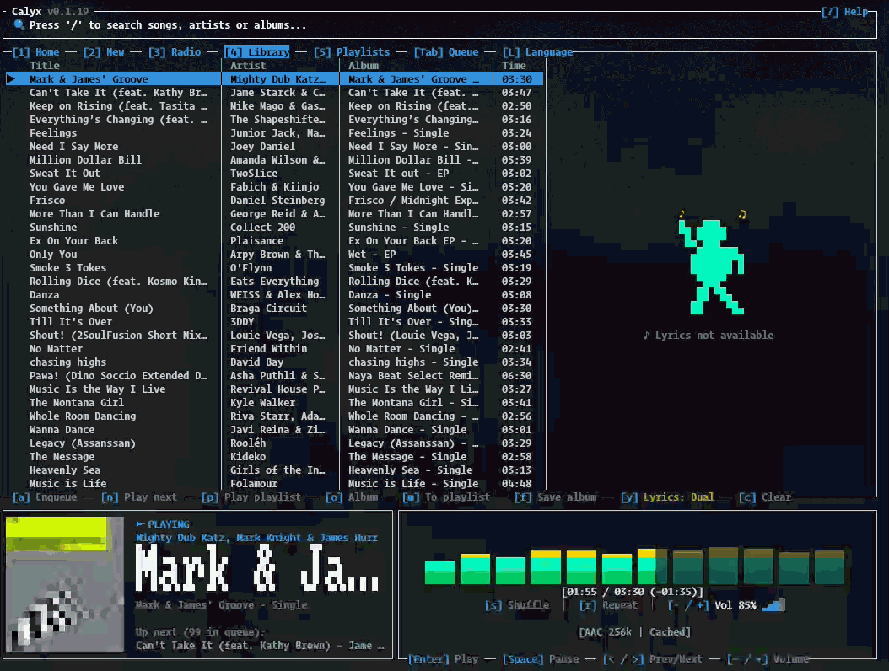

# Calyx 🎵

<p align="center">
  <a href="README.md">English</a> · <b>Español</b>
</p>

<p align="center">
  <a href="https://github.com/hector-horta/calyx/releases/latest"></a>
  
  
  
</p>

> **Un reproductor de Apple Music elegante, rápido y sin distracciones para tu terminal.**

<p align="center">
  
</p>

Calyx te permite escuchar todo el catálogo y tu biblioteca personal de Apple Music directamente desde la consola, con carátulas en arte ASCII, visualizador de audio en tiempo real, letras animadas sincronizadas y control total con el teclado.

---

## ✨ Características

- 🎧 **Audio de Alta Fidelidad**: Reproducción fluida en calidad AAC 256 kbps sin publicidad ni interrupciones.
- ⚡ **Reproducción Continua (Gapless)**: Cambios de canción instantáneos con prefetching en segundo plano, sin baches de silencio.
- 🎤 **Letras en Tiempo Real**: Las letras avanzan e iluminan cada sílaba en TrueColor al compás de la voz (estilo karaoke).
- 🈳 **Pronunciación Fonética (`y`)**: Transliteración automática a alfabeto latino (Romaji) para canciones en japonés (Kanji/Kana) o coreano (Hangul).
- 🌈 **Visualizador de Espectro**: Reproductor equilibrado de dos cajas con animación de frecuencias retroiluminada de 48 pasos.
- 📁 **Biblioteca y Playlists**: Accede a tus listas guardadas, añade canciones (<kbd>m</kbd>), guarda álbumes (<kbd>f</kbd>) o crea listas nuevas al instante.
- 🌐 **Bilingüe (Español / English)**: Detecta el idioma de tu sistema y permite alternar en caliente con la tecla <kbd>L</kbd>.
- 💻 **Multiplataforma**: Rendimiento nativo en Windows, macOS y Linux.

---

## 🚀 Instalación y Uso Rápido

### 1. Requisitos
Asegúrate de tener [Rust y Cargo instalados](https://rustup.rs/).

### 2. Clonar y Ejecutar
```sh
# Clonar el proyecto
git clone https://github.com/hector-horta/calyx.git
cd calyx

# Iniciar el reproductor (catálogo por defecto: Estados Unidos)
cargo run -p calyx-tui
```

> 💡 **Consejo regional**: Si quieres explorar recomendaciones y novedades de un país específico, puedes pasar su código de 2 letras al arrancar (por ejemplo: `cargo run -p calyx-tui -- mx` para México, `es` para España o `ar` para Argentina).

---

## 🔑 Iniciar Sesión (Apple Music)

Para escuchar tus canciones completas, tus playlists y tu biblioteca personal:

1. Abre Calyx y presiona la tecla <kbd>u</kbd>.
2. Se abrirá automáticamente tu navegador habitual con la página oficial de Apple Music.
3. Inicia sesión normalmente. Calyx detectará tu cuenta y volverá a la terminal listo para reproducir.

> [!WARNING]
> **Safari en macOS: usa otro navegador para iniciar sesión.** Safari envía los enlaces de `music.apple.com` a la app Música: la pestaña queda en blanco y el inicio de sesión nunca ocurre. Si Safari es tu navegador predeterminado, inicia Calyx con otro navegador que tengas instalado:
>
> ```bash
> calyx -u chrome     # o firefox, edge, brave…
> ```

**Elegir el navegador:** `calyx -u <navegador>` abre Calyx e inicia sesión de inmediato en ese navegador, aunque no sea el predeterminado. Opciones: `chrome`, `chromium`, `edge`, `brave`, `arc`, `firefox`, `librewolf`, `zen`, `safari`, `orion`, `epiphany`.

*(Si necesitas configurarlo en servidores remotos o entornos SSH sin navegador gráfico, presiona <kbd>?</kbd> dentro de Calyx para ver la guía de configuración manual).*

---

## ⌨️ Atajos de Teclado

### 🧭 Navegación y Búsqueda
| **Tecla** | **Acción** |
|:---:|:---|
| <kbd>/</kbd> | **Buscar** canciones, artistas o álbumes en el catálogo |
| <kbd>1</kbd> a <kbd>5</kbd> | **Secciones**: `1` Recientes, `2` Novedades, `3` Radio, `4` Tu Biblioteca, `5` Playlists |
| <kbd>o</kbd> | **Ver Álbum**: Abre el álbum de la canción seleccionada (pulsar de nuevo para volver) |
| <kbd>Tab</kbd> | **Alternar vista**: Cambia entre la lista que estás explorando y tu Cola activa |
| <kbd>?</kbd> | **Pantalla de Ayuda** con guía de controles integrada |

### 🎵 Reproducción y Sonido
| **Tecla** | **Acción** |
|:---:|:---|
| <kbd>Enter</kbd> | **Reproducir** la canción seleccionada |
| <kbd>Espacio</kbd> | **Pausar / Reanudar** |
| <kbd>&lt;</kbd> / <kbd>&gt;</kbd> *(o <kbd>,</kbd> / <kbd>.</kbd>)* | **Pista Anterior / Siguiente** |
| <kbd>+</kbd> / <kbd>-</kbd> | **Subir / Bajar volumen** (±5%) |
| <kbd>s</kbd> | **Modo Aleatorio** (`🔀 ON` / `OFF`) |
| <kbd>r</kbd> | **Modo Repetir** (`🔁 Todo` ➔ `🔂 Una canción` ➔ `Off`) |
| <kbd>p</kbd> | **Reproducir Todo**: Reproduce la lista o playlist completa |

### 📋 Gestión de Canciones y Listas
| **Tecla** | **Acción** |
|:---:|:---|
| <kbd>a</kbd> | **Encolar al final** de la reproducción |
| <kbd>n</kbd> | **Encolar a continuación** (*Play Next*) |
| <kbd>A</kbd> | **Encolar Toda la Lista** actual |
| <kbd>f</kbd> | **Favorito / Guardar**: Añade el álbum completo a tu Biblioteca |
| <kbd>m</kbd> | **Añadir a Playlist**: Abre el menú para guardarla en una lista existente o crear una nueva |
| <kbd>d</kbd> | **Quitar**: Quita de la Cola; en una Playlist abierta, presionar dos veces para borrarla |
| <kbd>c</kbd> | **Limpiar**: Vacía la cola activa o el historial |

### ⚙️ Preferencias
| **Tecla** | **Acción** |
|:---:|:---|
| <kbd>y</kbd> | **Pronunciación Fonética**: Alterna entre letra original, fonética o modo dual |
| <kbd>L</kbd> | **Cambiar Idioma**: Alterna al instante entre Español e Inglés |
| <kbd>u</kbd> | **Iniciar sesión** con tu cuenta de Apple Music |
| <kbd>V</kbd> | **Nueva versión**: Abre la página de descarga cuando la barra superior muestra `→ vX.Y.Z disponible` |
| <kbd>q</kbd> | **Salir** de Calyx |

---

## 💡 Preguntas Frecuentes

- **¿Dónde se guarda mi sesión y configuración?**
  Calyx almacena tu sesión en las carpetas estándar de usuario de tu sistema (`%APPDATA%\calyx` en Windows, `~/.config/calyx` en Linux, `~/Library/Application Support/calyx` en macOS).
- **¿Calyx guarda música en mi disco?**
  Para que la música suene fluida y sin cortes, Calyx mantiene una pequeña caché temporal de audio en tu carpeta personal (`~/.cache/calyx/audio/`), la cual se autolimpia de forma automática mediante política LRU para no exceder los 2 GB.
- **¿Puedo usarlo en modo portátil?**
  Sí, si defines la variable de entorno `CALYX_HOME=/ruta/carpeta`, Calyx guardará todos sus datos en esa ubicación sin tocar el resto de tu equipo.
- **¿Cómo sé si hay una versión nueva?**
  La barra superior muestra tu versión (`Calyx v0.1.15`). Una vez al día Calyx consulta en segundo plano la última versión publicada en GitHub; si hay una más nueva, agrega `→ v0.1.16 disponible`. Presiona `V` dos veces para instalarla: Calyx descarga la release, verifica su SHA-256 y reemplaza su propio ejecutable; la nueva versión corre al reiniciar. Si no puede (instalado con cargo, scoop, winget, Homebrew o Nix, o sin permiso de escritura en su carpeta), abre la página de descarga. Nunca se actualiza sin que se lo pidas. Usa `--no-update-check` para que no se conecte nunca a GitHub.

---

## 📄 Licencia

Este proyecto está bajo la [Licencia MIT](LICENSE).
